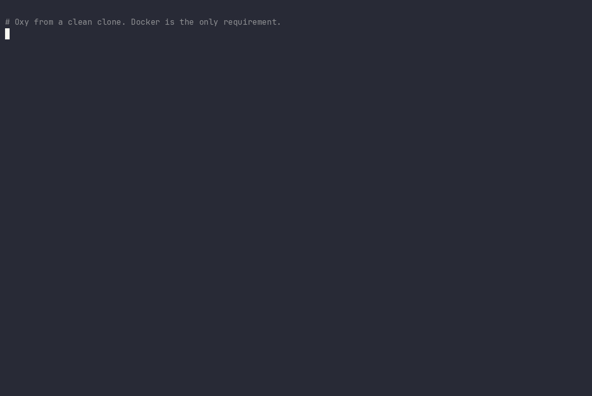

# Oxy

[](https://github.com/heyvaldemar/oxy-llm-gateway/actions/workflows/ci.yml)
[](https://scorecard.dev/viewer/?uri=github.com/heyvaldemar/oxy-llm-gateway)
[](LICENSE)
[](https://github.com/heyvaldemar/oxy-llm-gateway/blob/status/status.json)
[](https://github.com/heyvaldemar/oxy-llm-gateway/blob/status/status.json)

A self-hosted LLM gateway with budgets, guardrails, DLP, kill switch, and cost analytics. Runs end-to-end on a single `docker compose up` — no cloud accounts required.

> Apache 2.0, built by two co-authors as a reference implementation of an LLM gateway. The main claims below are measured in CI against a recording fake provider, and each measurement is shown the bug it exists to catch: see [Proofs](#proofs).

The last two badges are not typed by hand: they are CI's proofs over the last 30 days on main, rewritten after every run by [`.github/workflows/status.yml`](.github/workflows/status.yml) into the [`status`](https://github.com/heyvaldemar/oxy-llm-gateway/tree/status) branch.

## What's here

A complete control plane for LLM traffic, split across:

- **`packages/engine`** — FastAPI gateway exposing an OpenAI-compatible `/v1/chat/completions` endpoint with provider routing (OpenAI, Anthropic, Gemini, and any OpenAI-compatible endpoint through `OPENAI_API_BASE`), per-project budgets, response caching, DLP, kill switch, audit logs, and cost attribution. 455 offline unit tests.
- **`packages/ui`** — Next.js dashboard for keys, agents, budgets, privacy modes, audit logs, billing, intelligence, and playground.
- **`db/`** — Postgres golden schema plus a Supabase-compatibility shim so the same code runs on either a hosted Supabase project or a local self-hosted stack.
- **`docker-compose.yml`** — the local stack: Postgres, PostgREST, GoTrue (auth), Mailpit (local mail for magic links), nginx (URL-shape adapter), Redis, the engine with six background workers, and the UI.

## Quickstart

```bash
git clone https://github.com/heyvaldemar/oxy-llm-gateway.git
cd oxy-llm-gateway
docker compose up -d --build --wait
```



The terminal recording comes from Walkthrough run [43813025035](https://github.com/heyvaldemar/oxy-llm-gateway/actions/runs/43813025035) on 2026-11-16, with the script as of `6add5aa` (the magic link, the session token and the API key reach curl on its standard input): [`.github/workflows/walkthrough.yml`](.github/workflows/walkthrough.yml) ran [`scripts/walkthrough.sh`](scripts/walkthrough.sh) under asciinema on a clean GitHub runner, and the script prints every command and runs it as printed. That run's cast is [`docs/walkthrough.cast`](docs/walkthrough.cast) (`asciinema play docs/walkthrough.cast`); the GIF was rendered from it afterwards, outside CI, with `agg --speed 2` (the script hides the build output).

The first build takes a few minutes. No `.env` file, cloud account or provider key is needed to start. Then:

- Dashboard: <http://localhost:3000>
- Engine: <http://localhost:8000/health>
- Mail: <http://localhost:8025> (Mailpit catches the sign-in links)
- Auth + REST API: <http://localhost:8080> (Supabase URL shape)

Sign in at <http://localhost:3000/login> with any email address and open the magic link in Mailpit. During onboarding, add a provider key (OpenAI, Anthropic or Gemini), or add it later in Settings; until a provider is connected the dashboard shows demo data. Then create an API key in the dashboard and send a request:

```bash
# curl reads the key from its standard input (--config -), so it never stands on
# curl's command line, where any user of the machine could read it with ps.
oxy() { printf 'header = "Authorization: Bearer %s"\n' "$OXY_API_KEY" | curl --config - "$@"; }

oxy -X POST http://localhost:8000/v1/chat/completions \
  -H "Content-Type: application/json" \
  -d '{
    "model": "gpt-4.1-mini",
    "messages": [{"role": "user", "content": "hello"}]
  }'
```

To check the whole path without a provider key, run the same end-to-end test CI runs. It signs up a throwaway user, follows a magic link through Mailpit, gets an Oxy API key and asks the gateway's healthcheck model for "pong":

```bash
bash scripts/stack_smoke.sh
```

To go further by hand, the [workshop](docs/workshop/README.md) is a lab of about 80 minutes that starts from this quickstart and has you meet each control: a request the budget cannot cover, a secret stopped by DLP, a killed agent session, a revoked key, and the audit row each one leaves.

## Try it in a Codespace

[](https://codespaces.new/heyvaldemar/oxy-llm-gateway?quickstart=1)

The codespace (4 cores, 16 GB) builds and starts the whole stack with the recording fake provider from `proofs/` in place of a model provider, so no key is needed and no request leaves the codespace. The stack runs on secrets generated for the codespace on its first start, not on the published development defaults, and on every start `.devcontainer/start.sh` makes a fresh demo organization, project, API key and agent session and puts them in the terminal's environment; none of it is stored in the repository. The dashboard opens on port 3080: sign in as `$OXY_DEMO_EMAIL`, and the link arrives in Mailpit on port 8025.

In a terminal:

<!-- codespace-requests:start -->
```bash
# curl reads the key from its standard input (--config -), so it never stands on
# curl's command line, where any user of the machine could read it with ps.
oxy() { printf 'header = "Authorization: Bearer %s"\n' "$OXY_API_KEY" | curl --config - "$@"; }

# 1. A request through the gateway; the fake provider answers
oxy -s -w '\nHTTP %{http_code}\n' localhost:8000/v1/chat/completions \
  -H 'Content-Type: application/json' \
  -d '{"model":"gpt-4o-mini","messages":[{"role":"user","content":"hello"}]}'

# 2. The same request carrying a GitHub token, made up on the spot: DLP refuses it (451)
oxy -s -w '\nHTTP %{http_code}\n' localhost:8000/v1/chat/completions \
  -H 'Content-Type: application/json' \
  -d '{"model":"gpt-4o-mini","messages":[{"role":"user","content":"deploy with ghp_'"$(openssl rand -hex 18)"'"}]}'

# 3. Kill the demo agent session, then send one more request in it (410)
oxy -s -w '\nHTTP %{http_code}\n' -X POST localhost:8000/v1/agent-sessions/$OXY_SESSION_ID/kill
oxy -s -w '\nHTTP %{http_code}\n' localhost:8000/v1/chat/completions \
  -H 'Content-Type: application/json' \
  -H "X-Oxy-Agent-Id: $OXY_AGENT_ID" -H "X-Oxy-Session-Id: $OXY_SESSION_ID" \
  -d '{"model":"gpt-4o-mini","messages":[{"role":"user","content":"next step"}]}'
```
<!-- codespace-requests:end -->

A demonstration, not a measurement: CI builds this devcontainer and runs these requests as printed, plus the smoke test (job **Codespace devcontainer, smoke and the README's requests**), and the measured claims are the [Proofs](#proofs). The session stays killed: a second run of the third request answers 404 for the kill and 410 again.

## Architecture

```
        ┌──────────┐                                 ┌─────────────────┐
Browser │   UI     │────────── HTTP :3000 ───────────│  Next.js 16     │
        │ (Next.js)│                                 │  + Turbopack    │
        └────┬─────┘                                 └────────┬────────┘
             │                                                │ SSR
             │                          ┌─────────────────────┘
             │ /auth/v1 + /rest/v1                            
             ▼                                                
        ┌──────────────────────────────────────────────────┐   
        │  nginx-postgrest :8080  (path-shape adapter)     │   
        │  /auth/v1/*  →  gotrue:9999                      │   
        │  /rest/v1/*  →  postgrest:3000                   │   
        └─────────┬─────────────────────────┬───────────────┘   
                  │                         │                  
                  ▼                         ▼                  
            ┌──────────┐              ┌──────────┐             
            │ GoTrue   │              │ PostgREST│             
            │ (auth)   │              │ (REST)   │             
            └─────┬────┘              └─────┬────┘             
                  │                         │                  
                  └────────────┬────────────┘                  
                               ▼                               
                      ┌─────────────────┐                      
                      │   Postgres 16   │                      
                      │  schema + RLS   │                      
                      └─────────────────┘                      
                                                               
        ┌─────────────────┐         ┌─────────────────┐        
   API  │  Engine :8000   │◄────────│  Redis 7        │        
        │  (FastAPI)      │         │  cache + state  │        
        └────────┬────────┘         └─────────────────┘        
                 │                                             
                 ▼                                             
        ┌─────────────────┐                                    
        │ OpenAI /Anthropic                                    
        │ /Gemini /Ollama │  outbound LLM calls                
        │ /vLLM           │                                    
        └─────────────────┘                                    
```

The same gateway code path runs against a hosted Supabase project (set `SUPABASE_URL` to your project) or against the bundled local stack (the default). PostgREST + GoTrue replace the equivalent Supabase Cloud services, sharing one JWT secret so tokens flow through to row-level security unchanged.

## Feature surface

What the gateway does today (heuristic where noted, best-effort, no SLA); what is not wired yet is listed under [Scope and honest limitations](#scope-and-honest-limitations):

- **Budgets** — a spend cap per project, reserved atomically before a request reaches a provider and settled at the real cost after it; email alerts at 80, 95 and 100% through SendGrid when `EMAIL_ENABLED` and `SENDGRID_API_KEY` are set. Agents have budget fields in the schema, but the request path enforces the project's cap only
- **Kill switch** — best-effort stop on agent sessions, blocks further requests
- **Loop detection** — heuristic detection of repeated/stuck agent calls
- **Response caching** — deterministic requests (`temperature` 0) cached in Redis per organization for 7 days; a hit is still recorded and charged to the budget
- **Cost optimizer** — heuristic recommendations (model switch, caching, throttling) based on recent request logs
- **Request export** — the organization's request log as CSV (`GET /v1/exports/requests.csv`)
- **Privacy modes** — `zero_prompt_logging`, `metadata_only`, `debug_full`
- **DLP** — regex detection before a request leaves the gateway: API keys and tokens (OpenAI, Anthropic, AWS, Stripe live, GitHub, Slack, Google), JWTs, private keys and card numbers. Email addresses alone are not blocked.
- **Audit logs** — a `request_logs` row for every request made with a valid key, refusals included (by the budget, DLP, the kill switch, the burst limit, a suspended organization, a body that is not JSON), kept when the key is revoked; and an admin audit log; a retention window per organization is stored (`/v1/privacy`)
- **Rate limiting and security headers** — per-key throttling, HSTS/CSP/etc.
- **Geo / IP protections** — header-first country/region blocking
- **Notification settings** — Slack, Discord and Zapier webhook URLs and events per organization are stored (`/v1/notifications/settings`); see below for what is delivered
- **Self-hosted models** — any OpenAI-compatible endpoint (vLLM, Ollama's OpenAI API, an inference gateway) through `OPENAI_API_BASE`, as the proofs' fake provider is wired. The dedicated Ollama and vLLM adapters in `providers/` are not reachable from the gateway yet: it requires a stored provider key for them, which the `providers` table cannot hold
- **Intelligence + security score** — heuristic dashboard signals (advisory only)

For the canonical mapping between feature, code, tests, and docs see `docs/product/FEATURE_MATRIX.yml`.

## Where it fits

Three public repositories, three places to stop an AI request before it does damage:

| Repository | Where it stands | What it enforces |
|---|---|---|
| [kubernetes-air-gapped-ai-agent](https://github.com/heyvaldemar/kubernetes-air-gapped-ai-agent) | inside a cluster with no route to the internet | the boundary at the tool server: the agent reaches tools only through MCP, models arrive as signed weights checked at admission |
| [kubernetes-llm-inference-gateway](https://github.com/heyvaldemar/kubernetes-llm-inference-gateway) | in front of self-hosted model replicas | routing by queue and cache across vLLM replicas behind the Gateway API Inference Extension, cost per token measured |
| Oxy (this repository) | in front of model providers, hosted or self-hosted | a budget per project, DLP, a kill switch for agent sessions, an audit row for every authenticated request |

Oxy speaks the OpenAI API on both sides, so an inference gateway like the second one can sit behind it as one more OpenAI-compatible provider. The three have not been run together yet.

## Proofs

`proofs/run_proofs.py` starts from a running stack whose engine sends every OpenAI-model request to a fake provider that records what it receives (`proofs/docker-compose.proofs.yml`). Each proof signs up its own users; secrets are generated at random on every run.

| Claim | Measured |
|---|---|
| A budget is never overspent | 501 requests, 100 at a time, against a $0.05 budget: the provider served 35 completions, exactly what the budget buys; overspend $0. After the budget worker's sync cycles, 0 of 20 more were served, and 0 of 20 after Redis lost the spend counter |
| DLP stops secrets before the provider | 11 secret types sent; 0 reached the provider; a clean control request did |
| The kill switch stops a session | 260 requests started after `POST /v1/agent-sessions/{id}/kill` returned; 0 reached the provider; first blocked response 146 ms after the call. Another tenant's kill attempt answered 404 |
| One tenant cannot act as another's agent | 25 requests carrying another tenant's agent and session ids: 25 refused with 403, 0 reached the provider, 0 logged against that tenant's agent |
| A revoked key stops at once | a key used a moment before (so cached) is revoked: 10 of 10 next requests refused with 401, 0 reached the provider |
| Without Redis, nothing unchecked gets through | Redis paused for 8.2 s: 4 requests against a budget answered 503, 4 in a killed session 410 (decided by Postgres); 0 of the 8 reached the provider. 2 requests needing neither check were served |
| The browser cannot reach the engine's data | 27 database functions called through PostgREST with the public anon key and with a user's token: 0 callable; 41 tables, all with row-level security; 0 policies open to the browser roles |
| No API key is stored in Redis | 10 tenants' keys checked against every name and value of 45 Redis keys: 0 found |
| Every request is audited | 963 requests sent with a valid key by the proofs above, 963 `request_logs` rows, refusals included, 5 of them refused by the burst limit (429). A key revoked in the dashboard kept all 4 of its rows; `request_logs.api_key_id` is `ON DELETE SET NULL` |

`proofs/plant_violations.py` then plants, one at a time, the bug each proof exists for (a non-atomic reservation, the old spend ledger that reset every minute, DLP switched off, the kill state ignored, another tenant's ids accepted, a revoked key left in the cache, fail-open checks when Redis is down, the database functions and an open policy re-granted to the browser roles, the cache named by the raw key, audit writes dropped, a dashboard revoke that deletes the key and cascades its audit rows, a burst-limited request left without its row), requires that proof to fail, and restores the code. CI runs both on every push and daily (job **Proofs, each shown its planted violation**) and keeps the JSON; the branch `status` keeps the last 30 days.

```bash
docker compose -f docker-compose.yml -f proofs/docker-compose.proofs.yml up -d --build --wait
python3 proofs/run_proofs.py
python3 proofs/plant_violations.py
```

Every number in this table comes from one run: CI run [43776441730](https://github.com/heyvaldemar/oxy-llm-gateway/actions/runs/43776441730) (job [Proofs, each shown its planted violation](https://github.com/heyvaldemar/oxy-llm-gateway/actions/runs/43776441730/job/133003693181)) on 2026-11-15, the push to `main` of the commit tagged [v1.0.3](https://github.com/heyvaldemar/oxy-llm-gateway/releases/tag/v1.0.3) (`85c5ae0`), where all nine proofs held and all twelve planted violations were caught. The stack is the default one, a single engine process on a GitHub-hosted runner. The latest run's numbers, with its run id, are in [`status.json`](https://github.com/heyvaldemar/oxy-llm-gateway/blob/status/status.json); they move a little from run to run (the kill switch's first refusal, the number of requests sent).

## Scope and honest limitations

- **No SLAs.** Uptime, latency, retention, savings, and security are all best-effort.
- **Intelligence, optimizer, forecasts, and scores are heuristic.** Treat them as advisory, not billing truth or compliance certification.
- **The vault shim uses pgcrypto AES with a configurable key.** It is intentionally weaker than Supabase's pgsodium-backed Vault. Review `db/supabase-compat.sql` before storing real provider keys in it.
- **Email auto-confirm is on by default** so signups work without SMTP. Disable `GOTRUE_MAILER_AUTOCONFIRM` and configure SMTP for any deployment that handles real users.
- **A budget is the project's total spend**, not a monthly allowance: nothing resets it. The Redis counter is the ledger; the budget worker copies it to `projects.current_spend` every 60 s, and if Redis loses the counter it resumes from that copy, so at most the last minute's spend can be spent again.
- **Not wired in this release.** These have code or schema in the repository but do not work end to end, and the dashboard does not offer them: accepting team invitations (`/management/team/invite/accept` answers 501; an operator adds members in `organization_members`); SSO sign-in (`/auth/sso/callback` answers 501, three database functions are missing); exporting a user's data (`/management/export-data` answers 501, its database function is missing); delivery to registered webhooks and the Slack, Discord and Zapier alerts; cost-spike auto-suspend (the worker reads a column that does not exist); scheduled deletion by the retention window; approving an MCP tool call; redeeming referral credits; cost attribution tags (nothing writes them); key-rotation headers; the dedicated Ollama and vLLM adapters; enforcing agent budgets, team-member caps and per-tool MCP limits.
- **Without Redis the gateway refuses what it cannot check.** A request against a budget answers 503; a request in an agent session is decided by the session's row in Postgres, or refused. Other requests are still served, a little slower (the API key is looked up in Postgres).

## Tech stack

- Backend: Python 3.12, FastAPI, asyncpg-style PostgREST client (custom over httpx), structlog, Redis with Lua scripts for atomic budget operations
- Frontend: Next.js 16 (App Router, Turbopack), TypeScript strict, supabase-js + `@supabase/ssr`, Radix UI primitives, Tailwind
- Data: Postgres 16, PostgREST 12, GoTrue (Supabase Auth) v2
- Infra: docker-compose, nginx (path adapter), Caddy for TLS
- Tests: pytest (455 offline tests), Playwright + Vitest on the UI

## Repository layout

```
oxy/
├── packages/
│   ├── engine/        # FastAPI gateway (routes/, core/, middleware/, providers/, workers/)
│   └── ui/            # Next.js dashboard (src/app/, src/components/, src/lib/)
├── db/
│   ├── schema.sql              # Golden schema (3000+ lines)
│   └── supabase-compat.sql     # Auth/vault/role shim for self-hosted Postgres
├── nginx/postgrest.conf        # URL-shape adapter for local stack
├── docker-compose.yml          # Local stack (14 containers)
├── docker-compose.prod.yml     # Deployment with TLS via Caddy
├── docs/                       # Operator documentation
├── scripts/                    # Dev menu, test runners, schema initializer
├── DEPLOY.md                   # Hosted-Supabase deployment guide
├── SECURITY.md                 # Cryptography, RLS, audit, incident response
└── DEV_NOTES.md                # Daily development workflows
```

## Running the tests

```bash
make test-core          # 455 offline unit tests, a few seconds
make test-integration   # requires a running engine + live external services
```

UI:

```bash
cd packages/ui
pnpm test               # vitest
pnpm test:e2e           # playwright
```

## Configuration

The dev stack ships local defaults in `docker-compose.yml`; `packages/engine/.env` and `packages/ui/.env.local` are optional overrides. Read [SECURITY.md](SECURITY.md) before exposing it. For a deployment others can reach, see `packages/engine/ENV.example` and `DEPLOY.md`. Key environment variables:

| Variable | Purpose |
|---|---|
| `SUPABASE_URL` | Point engine at hosted Supabase or local nginx (default `http://nginx-postgrest:8080`) |
| `SUPABASE_SERVICE_KEY` | Service-role JWT signed with `SUPABASE_JWT_SECRET` |
| `SUPABASE_JWT_SECRET` | Shared between GoTrue, PostgREST, and JWTs (default is dev-only) |
| `SUPABASE_VAULT_KEY` | AES key for `vault.create_secret` in the compat shim |
| `REDIS_URL` / `REDIS_PASSWORD` | Cache and atomic state |
| `AUTHENTICATOR_PASSWORD` | PostgREST's database password. Unset, the database's first boot generates one (`db/03-authenticator-password.sh`) |
| `OPENAI_API_KEY`, `ANTHROPIC_API_KEY`, `GOOGLE_API_KEY` | Optional org-wide provider keys (or configure them per organization in the UI) |
| `ALLOWED_ORIGINS` | Browser origins allowed to call the engine (default `http://localhost:3000`) |
| `NEXT_PUBLIC_SITE_URL` | Public URL of the UI, used for sign-in redirects and metadata |
| `STRIPE_SECRET_KEY`, `STRIPE_WEBHOOK_SECRET` | Optional. Without them the Stripe endpoints answer 503 and everything else works |

## Dependencies

Dependabot proposes patch and minor updates once a week, once a release is seven days old, one grouped pull request per ecosystem: GitHub Actions, the engine's Python packages, the UI's npm packages and the Dockerfiles' base images. [`dependabot-automerge.yml`](.github/workflows/dependabot-automerge.yml) merges such a pull request once CI, with the proofs and the devcontainer, and CodeQL pass for its commit, and only when every dependency it moves is stated as a patch or minor update. The images pinned by digest in the compose files are checked each week by [`freshness.yml`](.github/workflows/freshness.yml), the fleet's freshness check. They are not refreshed automatically: a pin that fell behind fails that workflow, the fleet's heartbeat reports the red run (it watches every public repository's workflows, including a schedule GitHub switches off after 60 quiet days), and the bump is made by hand in a pull request that passes the same checks as any other.

Major versions are not proposed: each is a migration, made by hand in its own pull request. A known vulnerability is not left to them: CI runs `pip-audit` on the engine's requirements and `pnpm audit` on the UI's production dependencies (high and critical) on every push and pull request and every day, and fails when it finds one, whether its fix is a major version or not. Held back on 2026-11-15, to be reviewed on **2027-02-15**:

- base images: Python 3.12 (3.15 is out) and Node 22 LTS (26 is out);
- engine: `anthropic` 2, `redis` 8, `stripe` 17, `structlog` 26 (and `redis` stays on 5.2: with 5.3, concurrent commands queue behind each timeout while Redis does not answer, and the fail-closed proof timed out), and for development `pytest` 9, `pytest-asyncio` 1, `pytest-cov` 7, `black` 26, `isort` 9, `mypy` 2;
- UI: TypeScript 7, ESLint 10, Vite 8 with `@vitejs/plugin-react` 6, Vitest 5, jsdom 31, `@sentry/nextjs` 11, `framer-motion` 14, `lucide-react` 1, `sonner` 2, `@testing-library/jest-dom` 7, `@types/node` 26.

## License

Apache License 2.0: [LICENSE](LICENSE) holds the license text unchanged, [NOTICE](NOTICE) the copyright.

## Authors

Oxy has two co-authors and maintainers, with an equal share in it. Both of us shaped every part of it, from the first idea to the architecture, and each of us brought a different side of the same decade in DevOps.

- **Tatiana Mikhaleva** ([DevOpsPink](https://github.com/DevOpsPink), [devops.pink](https://devops.pink)), Docker Captain: the developer experience. How a team gets from `git clone` to its first working key with one `docker compose up`, the dashboard where a project owner sees spend, keys and every refusal, and the documentation that makes the gateway's rules obvious before they bite.
- **Vladimir Mikhalev** ([heyvaldemar](https://github.com/heyvaldemar), [heyvaldemar.com](https://heyvaldemar.com)): the security model. What Oxy refuses and why, behind the budgets, DLP, the kill switch and the audit trail, and the proofs in CI that show each control holding, each one shown the bug it exists to catch.

See [MAINTAINERS.md](MAINTAINERS.md).

## Status

A reference implementation, not a managed service: there is no SLA, and the heuristic features (optimizer, intelligence, scores) are advisory. Issues and pull requests are welcome.
